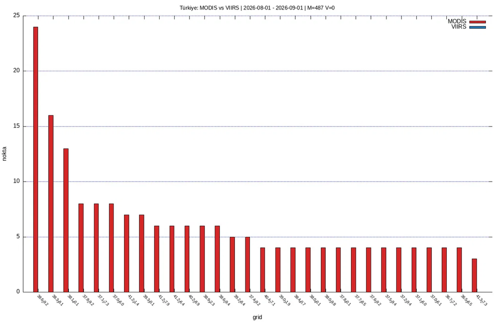

# AeroFire

> NASA Space Apps Challenge 2026 · Challenge: **Harmonization of MODIS and VIIRS Hot Spots**
> Team AeroFire · İskenderun, Hatay, Türkiye

**Live map:** https://ruzgarakar.github.io/aerofire/web/

## The problem
MODIS (about 1 km pixels) and VIIRS (375 m pixels) both report active fires from space, but they do not report them the same way. A single fire is recorded as one or two MODIS points and dozens of VIIRS points, so raw counts from the two sensors cannot be compared and the long MODIS record cannot simply be continued with VIIRS as MODIS reaches the end of its mission. A reader looking at raw counts sees VIIRS "finding" several times more fires than MODIS, which is mostly a resolution effect, not more fire.

## What AeroFire does
- **Harmonizes** MODIS and VIIRS detections: points are grouped into fires (same day, within 1.5 km), and both sensors are also counted on a shared daily 1 km grid, so the sensors can be compared on equal terms.
- **Shows the whole of Türkiye** with live monitoring: the map updates hourly from NASA FIRMS near-real-time data, with ranges of Live (last 7 days), 10 days, 1 month, 3 months, 6 months and 1 year. A **province report** shows, for any of the 81 provinces you click, the number of detections, the MODIS/VIIRS split, fire groups and the strongest fire. A **detection list** (newest first) gives every detection with its province and an approximate district.
- **Documents a real fire**: the Belen fire (Hatay, October 2020) is kept as a fixed case study with a fixed result.
- **Prototype (rule-based):** a settlement-exposure screening that combines live fires with current wind to flag villages, towns and cities that lie downwind, on a five-level scale (very low, low, moderate, high, very high). It is a simple rule-based screening, not a smoke dispersion model, and it uses no machine learning.

## How it works
```
NASA FIRMS (MODIS + VIIRS S-NPP + VIIRS NOAA-20)
   →  scripts/ (GitHub Actions: hourly live, daily archive)
   →  harmonize/harmonize.py  (fire groups, shared 1 km grid, static-source removal)
   →  web/data/*.json
   →  web/index.html, web/belen.html, web/risk.html  (Leaflet maps; Türkiye, Belen case study, settlement-risk prototype)
```

## Results
**Belen fire, Hatay, 8–12 October 2020 (fixed run, does not change):**

| | MODIS | VIIRS |
| --- | --- | --- |
| Raw detections | 42 | 191 |
| Raw VIIRS / MODIS ratio | 4.55× | |
| Ratio on the shared 1 km grid | 1.43× | |
| Fire groups | 17 (3 seen by both sensors) | |
| Largest fire (F-0001) | 30 MODIS / 148 VIIRS detections → 24 / 24 grid squares | |

On the shared grid the gap between the sensors shrinks from 4.55× to 1.43×.

**Türkiye (live):** the numbers on the live map change with the selected time range and with new data, so they are not fixed here.

## Run it yourself
```bash
# 1. Get a free FIRMS MAP_KEY: https://firms.modaps.eosdis.nasa.gov/api/map_key/
export MAP_KEY=your_key_here        # never commit your key (use a GitHub Actions secret)
# 2. Harmonize
python harmonize/harmonize.py --input data/processed/tr_archive.csv --output web/data/tr_year.json
# 3. Open web/index.html with any static server (e.g. VS Code Live Server)
```
On GitHub, `.github/workflows/live.yml` (hourly) and `archive.yml` (daily) update the data; the `MAP_KEY` secret must be set and workflow permissions must be "Read and write".

## Data sources
- NASA FIRMS active fire data: MODIS, VIIRS S-NPP and VIIRS NOAA-20 — https://firms.modaps.eosdis.nasa.gov
- Weather (settlement-risk prototype): Open-Meteo current 10 m wind — https://open-meteo.com
- Province boundaries (province report and detection list): GADM 4.1 — https://gadm.org (free for academic and non-commercial use)
- Settlements (villages, towns, cities) and district centres: GeoNames — https://www.geonames.org (CC BY 4.0)

## Known limitations
- **Data gaps (satellite events):** Nov 2025 – Aug 2026 comes from the FIRMS standard-processing archive. NASA reported an anomaly of the Suomi NPP satellite on 2 August 2026 (02:05 UTC); data from 3 August 02:00 UTC to 6 August 16:24 UTC was excluded from processing, and standard processing resumed on 10 August ([NASA Earthdata notice](https://www.earthdata.nasa.gov/data/alerts-outages/suomi-npp-viirs-data-outage-anomaly-august-2-2026)). In the FIRMS standard archive we pulled, August 2026 contains MODIS but no VIIRS records; we have not found an official explanation for the NOAA-20 part of this gap, so we simply mark August 2026 as MODIS-only. From 30 August 2026 the data comes from near-real-time (NRT) products.
- **August 2026:** VIIRS data could not be obtained for August 2026, so the month contains MODIS detections only (487 MODIS, 0 VIIRS). VIIRS/MODIS ratios that include this month are not comparable with other months.

  
- **End of Suomi NPP:** NOAA ended delivery of all Suomi NPP science products on 2 November 2026 ([NOAA NESDIS notice](https://www.nesdis.noaa.gov/news/cessation-of-suomi-national-polar-orbiting-partnership-s-npp-data-users-onafter-november-2-2026)). From that date our VIIRS data comes from NOAA-20 only, so VIIRS counts drop and the MODIS/VIIRS ratio before and after 2 November is not directly comparable.
- **NRT vs archive:** NRT has no static-source flag, so known static heat sources (e.g. industrial flares) are removed with a list derived from the archive. Counts may differ slightly from final standard-processing data.
- **Latency:** NASA near-real-time data arrives about three hours after satellite overpass; the live view is not instantaneous.
- **Detections are not fires or burned area:** one fire gives many detections. The harmonized grid reduces, but does not remove, the sensor difference.
- **Settlement-risk prototype:** a rule-based screening heuristic, not a smoke dispersion model. It uses the current 10 m wind only, ignores terrain, rain and smoke height, and does not estimate air quality or health effects. The five risk levels use thresholds we chose ourselves; they are not a scientific standard. Population comes from GeoNames, is missing for many villages and is therefore a lower bound.
- **Districts are approximate:** the district shown in the detection list and the risk table is the nearest district centre within the province (GeoNames), not a true district boundary. The province comes from real boundaries (GADM).

## Team
- Ahmet — leader, harmonization, backend
- Akay — Data,backend,Design
- Ceyhun — Frontend & Presentation
- Rüzgar — Research & impact

## Notes on preparation and AI use
- Before the event we prepared only the folder structure, empty templates and a data-download helper script. The harmonization logic, the maps and the results were built during the hackathon (14–15 November 2026).
- AI tools (Claude and DeepSeek) were used for coding and informational help, debugging and drafting text; every use is listed in `docs/AI_LOG.md`. The settlement-risk analysis itself is rule-based: no AI or machine-learning model produces the risk levels. We checked results by comparing them with NASA FIRMS data and with the fixed Belen result.

## License
MIT
